# Generated Product Map

Generated at `2026-10-12T05:38:18Z` by `scripts/generate_product_map.py`.

This file is generated from source. Re-run the script after UI or API changes.

## Summary

- Dashboard navigation items: `26`
- Tab/component mappings: `33`
- Sub-pane groups: `9`
- Backend HTTP routes discovered: `907` across `28` services
- Backend routes on the `pkg/route` kernel: `482` (permission and audit action in `backend-routes.csv`)
- Frontend API call sites discovered: `537`
- Frontend call sites with exact backend route match: `516`
- Frontend call sites needing review or dynamic/runtime confirmation: `21`
- Clickable controls with static `onClick` handlers: `770`
- Backend request flows with handler/service/package summaries: `907`

## How To Use This For Launch

1. Start with `Navigation To Services` and pick one product tab.
2. Review its service dependencies and then open the linked component/support files.
3. Use `Frontend Calls Needing Review` to find clicks that may hit missing, aliased, dynamic, or unimplemented routes.
4. Use `Backend Routes Not Directly Called From Dashboard` to decide whether each route is API-only, hidden behind a workflow, or dead weight.
5. Pair this static map with Playwright smoke tests and runtime request logging before launch.

## Visual Service Map

```mermaid
flowchart LR
  UI[Dashboard UI]
  tab_home["Command Center"]
  UI --> tab_home
  tab_home --> svc_auth_edge
  tab_recommendations["Recommendations"]
  UI --> tab_recommendations
  tab_recommendations --> svc_auth_edge
  tab_ops["Operations"]
  UI --> tab_ops
  tab_ops --> svc_audit
  tab_ops --> svc_auth_edge
  tab_ops --> svc_certs
  tab_ops --> svc_cluster_manager
  tab_ops --> svc_compliance
  tab_ops --> svc_governance
  tab_ops --> svc_keycore
  tab_ops --> svc_reporting
  tab_ops --> svc_secrets
  tab_keys["Key Management"]
  UI --> tab_keys
  tab_keys --> svc_auth
  tab_keys --> svc_keycore
  tab_crypto_agility["Crypto Agility"]
  UI --> tab_crypto_agility
  tab_crypto_agility --> svc_keycore
  tab_discovery["Crypto Discovery"]
  UI --> tab_discovery
  tab_discovery --> svc_compliance
  tab_discovery --> svc_discovery
  tab_certs["Certificates / PKI"]
  UI --> tab_certs
  tab_certs --> svc_certs
  tab_certs --> svc_keycore
  tab_vault["Secret Vault"]
  UI --> tab_vault
  tab_vault --> svc_auth_edge
  tab_vault --> svc_keycore
  tab_vault --> svc_secrets
  tab_ekm["Enterprise KM"]
  UI --> tab_ekm
  tab_ekm --> svc_ekm
  tab_ekm --> svc_tfe
  tab_hsm["HSM"]
  UI --> tab_hsm
  tab_hsm --> svc_auth
  tab_workload["Workload Identity"]
  UI --> tab_workload
  tab_workload --> svc_workload
  tab_confidential["Confidential Compute"]
  UI --> tab_confidential
  tab_confidential --> svc_confidential
  tab_audit["Audit Log"]
  UI --> tab_audit
  tab_audit --> svc_audit
  tab_alerts["Alert Center"]
  UI --> tab_alerts
  tab_alerts --> svc_auth_edge
  tab_alerts --> svc_reporting
  tab_approvals["Approvals"]
  UI --> tab_approvals
  tab_approvals --> svc_compliance
  tab_approvals --> svc_governance
  tab_posture["Posture"]
  UI --> tab_posture
  tab_posture --> svc_auth
  tab_posture --> svc_autokey
  tab_posture --> svc_keyaccess
  tab_posture --> svc_posture
  tab_posture --> svc_signing
  tab_posture --> svc_workload
  tab_compliance["Compliance"]
  UI --> tab_compliance
  tab_compliance --> svc_compliance
  tab_compliance --> svc_pqc
  tab_compliance --> svc_reporting
  tab_sbom["SBOM / CBOM"]
  UI --> tab_sbom
  tab_sbom --> svc_sbom
  tab_playbooks["Playbooks"]
  UI --> tab_playbooks
  tab_playbooks --> svc_compliance
  tab_playbooks --> svc_keycore
  tab_cluster["Cluster"]
  UI --> tab_cluster
  tab_cluster --> svc_auth_edge
  tab_cluster --> svc_cluster_manager
  tab_backup["Backup & Restore"]
  UI --> tab_backup
  tab_backup --> svc_backup
  tab_byok["byok"]
  UI --> tab_byok
  tab_byok --> svc_cloud
  tab_crypto["crypto"]
  UI --> tab_crypto
  tab_crypto --> svc_keycore
  tab_hyok["hyok"]
  UI --> tab_hyok
  tab_hyok --> svc_hyok
  tab_pkcs11["pkcs11"]
  UI --> tab_pkcs11
  tab_pkcs11 --> svc_ekm
  tab_pkcs11 --> svc_tfe
  tab_restapi["restapi"]
  UI --> tab_restapi
  tab_restapi --> svc_auth
  tab_restapi --> svc_auth_edge
  tab_restapi --> svc_certs
  tab_restapi --> svc_secrets
  svc_audit["audit (34 routes)"]
  svc_auth["auth (89 routes)"]
  svc_auth_edge["auth-edge"]
  svc_autokey["autokey (15 routes)"]
  svc_backup["backup (11 routes)"]
  svc_certs["certs (69 routes)"]
  svc_cloud["cloud (26 routes)"]
  svc_cluster_manager["cluster-manager (21 routes)"]
  svc_compliance["compliance (61 routes)"]
  svc_confidential["confidential (7 routes)"]
  svc_discovery["discovery (24 routes)"]
  svc_ekm["ekm (71 routes)"]
  svc_governance["governance (35 routes)"]
  svc_hyok["hyok (21 routes)"]
  svc_keyaccess["keyaccess (9 routes)"]
  svc_keycore["keycore (178 routes)"]
  svc_posture["posture (13 routes)"]
  svc_pqc["pqc (14 routes)"]
  svc_reporting["reporting (34 routes)"]
  svc_sbom["sbom (14 routes)"]
  svc_secrets["secrets (40 routes)"]
  svc_signing["signing (11 routes)"]
  svc_tfe["tfe"]
  svc_workload["workload (20 routes)"]
```

A standalone Mermaid file is also written to `docs/generated/product-map.mmd`.

## Navigation To Services

| Group | UI item | Tab id | Component | Service dependencies | Static call sites |
| --- | --- | --- | --- | --- | --- |
| Overview | Command Center | home | web/dashboard/src/components/v3/tabs/CommandCenterTab.tsx | auth-edge | 4 |
| Overview | Recommendations | recommendations | web/dashboard/src/components/v3/tabs/CommandCenterTab.tsx | auth-edge | 4 |
| Overview | Operations | ops | web/dashboard/src/components/v3/tabs/DashboardTab.tsx | audit, auth-edge, certs, cluster-manager, compliance, governance, keycore, reporting, secrets | 204 |
| Overview | Workbench | workbench | web/dashboard/src/components/v3/tabs/WorkbenchTab.tsx | - | 0 |
| Keys & lifecycle | Key Management | keys | web/dashboard/src/components/v3/tabs/KeysTab.tsx | auth, keycore | 96 |
| Keys & lifecycle | Rotation & Scheduling | rotation | web/dashboard/src/components/v3/tabs/RotationSchedulingTab.tsx | - | 0 |
| Keys & lifecycle | Crypto Agility | crypto_agility | web/dashboard/src/components/v3/tabs/CryptoAgilityTab.tsx | keycore | 12 |
| Keys & lifecycle | Crypto Discovery | discovery | web/dashboard/src/components/v3/tabs/DiscoveryTab.tsx | compliance, discovery | 23 |
| PKI & certificates | Certificates / PKI | certs | web/dashboard/src/components/v3/tabs/CertsTab.tsx | certs, keycore | 102 |
| Data & integrations | Secret Vault | vault | web/dashboard/src/components/v3/tabs/VaultTab.tsx | auth-edge, keycore, secrets | 75 |
| Data & integrations | Data Protection | dataprotection | web/dashboard/src/components/v3/tabs/DataProtectionTabs.tsx | - | 0 |
| Data & integrations | Cloud Key Control | cloudctl | web/dashboard/src/components/v3/tabs/CloudKeyControlTab.tsx | - | 0 |
| Data & integrations | Enterprise KM | ekm | web/dashboard/src/components/v3/tabs/EKMTab.tsx | ekm, tfe | 40 |
| Data & integrations | HSM | hsm | web/dashboard/src/components/v3/tabs/HSMTab.tsx | auth | 46 |
| Data & integrations | Workload Identity | workload | web/dashboard/src/components/v3/tabs/WorkloadIdentityTab.tsx | workload | 13 |
| Data & integrations | Confidential Compute | confidential | web/dashboard/src/components/v3/tabs/ConfidentialComputeTab.tsx | confidential | 6 |
| Security & compliance | Audit Log | audit | web/dashboard/src/components/v3/tabs/AuditLogTab.tsx | audit | 10 |
| Security & compliance | Alert Center | alerts | web/dashboard/src/components/v3/tabs/AlertsTab.tsx | auth-edge, reporting | 27 |
| Security & compliance | Approvals | approvals | web/dashboard/src/components/v3/tabs/GovernanceTab.tsx | compliance, governance | 24 |
| Security & compliance | Posture | posture | web/dashboard/src/components/v3/tabs/PostureTab.tsx | auth, autokey, keyaccess, posture, signing, workload | 95 |
| Security & compliance | Compliance | compliance | web/dashboard/src/components/v3/tabs/ComplianceTab.tsx | compliance, pqc, reporting | 46 |
| Security & compliance | SBOM / CBOM | sbom | web/dashboard/src/components/v3/tabs/SBOMTab.tsx | sbom | 12 |
| Security & compliance | Playbooks | playbooks | web/dashboard/src/components/v3/tabs/PlaybooksTab.tsx | compliance, keycore | 6 |
| Platform | Cluster | cluster | web/dashboard/src/components/v3/tabs/ClusterTab.tsx | auth-edge, cluster-manager | 15 |
| Platform | Backup & Restore | backup | web/dashboard/src/components/v3/tabs/BackupTab.tsx | backup | 10 |
| Platform | Administration | admin | web/dashboard/src/components/v3/tabs/AdminTab.tsx | - | 0 |
| UNLISTED | byok | byok | web/dashboard/src/components/v3/tabs/BYOKTab.tsx | cloud | 8 |
| UNLISTED | crypto | crypto | web/dashboard/src/components/v3/tabs/CryptoTab.tsx | keycore | 50 |
| UNLISTED | dataenc | dataenc | web/dashboard/src/components/v3/tabs/DataProtectionTabs.tsx | - | 0 |
| UNLISTED | hyok | hyok | web/dashboard/src/components/v3/tabs/HYOKTab.tsx | hyok | 7 |
| UNLISTED | pkcs11 | pkcs11 | web/dashboard/src/components/v3/tabs/ClientSDKTab.tsx | ekm, tfe | 40 |
| UNLISTED | restapi | restapi | web/dashboard/src/components/v3/tabs/RestAPITab.tsx | auth, auth-edge, certs, secrets | 123 |
| UNLISTED | tokenize | tokenize | web/dashboard/src/components/v3/tabs/DataProtectionTabs.tsx | - | 0 |

## Backend Route Counts

| Service | Routes | Frontend call sites |
| --- | --- | --- |
| audit | 34 | 21 |
| auth | 89 | 46 |
| autokey | 15 | 11 |
| backup | 11 | 10 |
| certs | 69 | 52 |
| cloud | 26 | 12 |
| cluster-manager | 21 | 11 |
| compliance | 61 | 28 |
| confidential | 7 | 6 |
| dataprotect | 49 | 28 |
| discovery | 24 | 22 |
| ekm | 71 | 43 |
| governance | 35 | 23 |
| hsm-connector | 14 | 0 |
| hyok | 21 | 7 |
| keyaccess | 9 | 6 |
| keycore | 178 | 93 |
| kmip | 12 | 11 |
| policy | 12 | 0 |
| posture | 13 | 10 |
| pqc | 14 | 8 |
| reconciler | 1 | 1 |
| reporting | 34 | 24 |
| sbom | 14 | 12 |
| secrets | 40 | 21 |
| signing | 11 | 9 |
| watchdog | 2 | 2 |
| workload | 20 | 13 |

## Frontend Calls Needing Review

These are not necessarily broken. Common reasons include dynamic wrapper paths, service aliases, edge auth routes, API-only calls, or routes generated outside `mux.HandleFunc`.

| Service | Method | Path | Source | File | Line |
| --- | --- | --- | --- | --- | --- |
| audit | POST | /audit/events | serviceRequest | web/dashboard/src/lib/auditLogger.ts | 20 |
| auth-edge | POST | /auth/logout | trackedFetch | web/dashboard/src/lib/auth.ts | 148 |
| auth-edge | POST | /auth/login | trackedFetch | web/dashboard/src/lib/auth.ts | 190 |
| auth-edge | POST | /auth/change-password | trackedFetch | web/dashboard/src/lib/auth.ts | 277 |
| auth-edge | POST | /auth/refresh | trackedFetch | web/dashboard/src/lib/auth.ts | 324 |
| auth | GET | /auth/identity/providers/{param}/users{param}` : ""} | serviceRequest | web/dashboard/src/lib/authAdmin.ts | 896 |
| auth | GET | /auth/identity/providers/{param}/groups{param}` : ""} | serviceRequest | web/dashboard/src/lib/authAdmin.ts | 926 |
| auth | GET | /auth/identity/providers/{param}/groups/{param}/members{param}` : ""} | serviceRequest | web/dashboard/src/lib/authAdmin.ts | 952 |
| cloud | GET | /cloud/accounts{param} | serviceRequest | web/dashboard/src/lib/cloud.ts | 121 |
| cloud | GET | /cloud/region-mappings{param} | serviceRequest | web/dashboard/src/lib/cloud.ts | 157 |
| cloud | GET | /cloud/inventory{param} | serviceRequest | web/dashboard/src/lib/cloud.ts | 203 |
| cloud | GET | /cloud/bindings{param} | serviceRequest | web/dashboard/src/lib/cloud.ts | 224 |
| compliance | GET | /compliance/playbooks/connections/{param}/test | serviceRequest | web/dashboard/src/lib/credentials.ts | 72 |
| compliance | GET | /compliance/playbooks/connections/{param} | serviceRequest | web/dashboard/src/lib/credentials.ts | 76 |
| tfe | GET | /tfe/file-encrypt/download | serviceRequest | web/dashboard/src/lib/ekm.ts | 899 |
| hyok | POST | /hyok/{param}/v1/keys/{param}/{param} | serviceRequest | web/dashboard/src/lib/hyok.ts | 180 |
| reporting | PUT | /alerts/{param}/acknowledge | serviceRequest | web/dashboard/src/lib/reporting.ts | 311 |
| reporting | PUT | /alerts/{param}/escalate | serviceRequest | web/dashboard/src/lib/reporting.ts | 350 |
| keycore | GET | /rotation/runs{param} | serviceRequest | web/dashboard/src/lib/rotationScheduler.ts | 88 |
| secrets | GET | /{param}&format={param}{param}` : ""} | serviceRequest | web/dashboard/src/lib/secrets.ts | 170 |
| secrets | DELETE | /secretURL(session, secretId, `/versions/{param}`) | serviceRequest | web/dashboard/src/lib/secrets.ts | 199 |

Showing `21` of `21`. Full data is in `docs/generated/product-map.json` and `docs/generated/frontend-calls.csv`.

## Backend Routes Not Directly Called From Dashboard

These may be public API routes, protocol integrations, routes used through SDKs, or unused implementation. They should be classified before launch.

| Service | Method | Path | Handler | Permission | File | Line |
| --- | --- | --- | --- | --- | --- | --- |
| audit | POST | /audit/publish | h.handlePublish |  | services/audit/handler.go | 72 |
| audit | POST | /audit/search | h.handleSearch |  | services/audit/handler.go | 78 |
| audit | GET | /audit/stream | h.handleStream |  | services/audit/handler.go | 80 |
| audit | POST | /audit/cluster/signing-key/join-key | h.handleClusterKeyJoinKey |  | services/audit/handler.go | 89 |
| audit | POST | /audit/cluster/signing-key/export | h.handleClusterKeyExport |  | services/audit/handler.go | 90 |
| audit | POST | /audit/cluster/signing-key/import | h.handleClusterKeyImport |  | services/audit/handler.go | 91 |
| audit | GET | /ops-metrics/timeseries | h.handleGetOpsTimeSeries |  | services/audit/handler.go | 98 |
| audit | GET | /audit/fips/boundary | h.handleFIPSBoundary |  | services/audit/handler.go | 104 |
| audit | GET | /audit/cbom/inventory | h.handleCBOMInventory |  | services/audit/handler.go | 107 |
| audit | GET | /audit/cbom/diff | h.handleCBOMDiff |  | services/audit/handler.go | 108 |
| audit | GET | /metrics | h.handlePrometheusMetrics |  | services/audit/handler.go | 111 |
| auth | DELETE | /auth/api-keys/{id} | h.deleteAPIKey | auth.api_key.write | services/auth/clients_admin.go | 30 |
| auth | POST | /auth/delegated/authority | h.delegatedAuthority | authenticated | services/auth/delegated.go | 77 |
| auth | POST | /auth/delegated/users/{id}/disable | h.delegatedDisableUser | authenticated | services/auth/delegated.go | 78 |
| auth | POST | /auth/delegated/api-keys/{id}/revoke | h.delegatedRevokeAPIKey | authenticated | services/auth/delegated.go | 79 |
| auth | POST | /auth/delegated/clients/{id}/revoke | h.delegatedRevokeClient | authenticated | services/auth/delegated.go | 80 |
| auth | GET | /auth/register/{id}/status | h.handleRegistrationStatus |  | services/auth/handler.go | 71 |
| auth | POST | /auth/login | h.handleLogin |  | services/auth/handler.go | 72 |
| auth | POST | /auth/client-token | h.handleClientToken |  | services/auth/handler.go | 73 |
| auth | POST | /auth/cluster/mint | h.handleClusterMint |  | services/auth/handler.go | 74 |
| auth | POST | /auth/workload-token | h.handleIssueWorkloadToken |  | services/auth/handler.go | 75 |
| auth | POST | /auth/refresh | h.withAuth(h.handleRefresh, "auth.token.refresh") |  | services/auth/handler.go | 77 |
| auth | POST | /auth/change-password | h.withAuth(h.handleChangePassword, "") |  | services/auth/handler.go | 78 |
| auth | POST | /auth/logout | h.withAuth(h.handleLogout, "auth.session.logout") |  | services/auth/handler.go | 81 |
| auth | GET | /auth/me | h.withAuth(h.handleMe, "auth.self.read") |  | services/auth/handler.go | 82 |
| auth | GET | /tenants/{id} | h.withAuth(h.handleGetTenant, "auth.tenant.read", "super-admin") |  | services/auth/handler.go | 86 |
| auth | POST | /tenants/{id}/roles | h.withAuth(h.handleCreateTenantRole, "auth.role.write", "super-admin") |  | services/auth/handler.go | 91 |
| auth | PUT | /tenants/{id}/roles/{name} | h.withAuth(h.handleUpdateTenantRole, "auth.role.write", "super-admin") |  | services/auth/handler.go | 92 |
| auth | DELETE | /tenants/{id}/roles/{name} | h.withAuth(h.handleDeleteTenantRole, "auth.role.write", "super-admin") |  | services/auth/handler.go | 93 |
| auth | GET | /auth/users | h.withAuth(h.handleListUsers, "auth.user.read") |  | services/auth/handler.go | 95 |
| auth | GET | /auth/identity/providers/{provider} | h.withAuth(h.handleGetIdentityProviderConfig, "auth.user.read") |  | services/auth/handler.go | 98 |
| auth | GET | /auth/identity/providers/{provider}/users | h.withAuth(h.handleListIdentityProviderUsers, "auth.user.read") |  | services/auth/handler.go | 101 |
| auth | GET | /auth/identity/providers/{provider}/groups | h.withAuth(h.handleListIdentityProviderGroups, "auth.user.read") |  | services/auth/handler.go | 102 |
| auth | GET | /auth/identity/providers/{provider}/groups/{id}/members | h.withAuth(h.handleListIdentityProviderGroupMembers, "auth.user.read") |  | services/auth/handler.go | 103 |
| auth | POST | /auth/sso/{provider}/callback | h.handleSSOCallback |  | services/auth/handler.go | 130 |
| auth | GET | /auth/sso/{provider}/callback | h.handleSSOCallback |  | services/auth/handler.go | 131 |
| auth | GET | /auth/sso/saml/metadata | h.handleSAMLMetadata |  | services/auth/handler.go | 132 |
| auth | GET | /scim/v2/ServiceProviderConfig | h.handleSCIMServiceProviderConfig |  | services/auth/handler.go | 138 |
| auth | GET | /scim/v2/Schemas | h.handleSCIMSchemas |  | services/auth/handler.go | 139 |
| auth | GET | /scim/v2/ResourceTypes | h.handleSCIMResourceTypes |  | services/auth/handler.go | 140 |
| auth | GET | /scim/v2/Users | h.handleSCIMListUsers |  | services/auth/handler.go | 141 |
| auth | POST | /scim/v2/Users | h.handleSCIMCreateUser |  | services/auth/handler.go | 142 |
| auth | GET | /scim/v2/Users/{id} | h.handleSCIMGetUser |  | services/auth/handler.go | 143 |
| auth | PUT | /scim/v2/Users/{id} | h.handleSCIMReplaceUser |  | services/auth/handler.go | 144 |
| auth | PATCH | /scim/v2/Users/{id} | h.handleSCIMPatchUser |  | services/auth/handler.go | 145 |
| auth | DELETE | /scim/v2/Users/{id} | h.handleSCIMDeleteUser |  | services/auth/handler.go | 146 |
| auth | GET | /scim/v2/Groups | h.handleSCIMListGroups |  | services/auth/handler.go | 147 |
| auth | POST | /scim/v2/Groups | h.handleSCIMCreateGroup |  | services/auth/handler.go | 148 |
| auth | GET | /scim/v2/Groups/{id} | h.handleSCIMGetGroup |  | services/auth/handler.go | 149 |
| auth | PUT | /scim/v2/Groups/{id} | h.handleSCIMReplaceGroup |  | services/auth/handler.go | 150 |
| auth | PATCH | /scim/v2/Groups/{id} | h.handleSCIMPatchGroup |  | services/auth/handler.go | 151 |
| auth | DELETE | /scim/v2/Groups/{id} | h.handleSCIMDeleteGroup |  | services/auth/handler.go | 152 |
| auth | POST | /internal/subjects/check | h.checkSubjects | authenticated | services/auth/subjects.go | 36 |
| auth | GET | /internal/tenant-ids | h.listTenantIDs | authenticated | services/auth/tenant_ids.go | 20 |
| autokey | POST | /autokey/templates | h.handleUpsertTemplate |  | services/autokey/handler.go | 34 |
| autokey | PUT | /autokey/templates/{id} | h.handleUpsertTemplate |  | services/autokey/handler.go | 35 |
| autokey | POST | /autokey/service-policies | h.handleUpsertServicePolicy |  | services/autokey/handler.go | 38 |
| autokey | PUT | /autokey/service-policies/{service} | h.handleUpsertServicePolicy |  | services/autokey/handler.go | 39 |
| backup | GET | /healthz | h.handleHealth |  | services/backup/handler.go | 48 |
| certs | GET | /certs/{id} | h.handleGetCert |  | services/certs/handler.go | 47 |
| certs | POST | /certs/profiles | h.handleCreateProfile |  | services/certs/handler.go | 52 |
| certs | GET | /certs/profiles/{id} | h.handleGetProfile |  | services/certs/handler.go | 54 |
| certs | POST | /certs/ocsp | h.handleOCSP |  | services/certs/handler.go | 57 |
| certs | GET | /certs/clm/policy | h.handleGetCLMPolicy |  | services/certs/handler.go | 62 |
| certs | GET | /acme/directory | h.handleACMEDirectory |  | services/certs/handler.go | 78 |
| certs | HEAD | /acme/new-nonce | h.handleACMENonce |  | services/certs/handler.go | 79 |
| certs | POST | /acme/new-nonce | h.handleACMENonce |  | services/certs/handler.go | 80 |
| certs | GET | /acme/renewal-info/{id} | h.handleACMERenewalInfo |  | services/certs/handler.go | 83 |
| certs | GET | /acme/cert/{id} | h.handleACMECertDownload |  | services/certs/handler.go | 87 |
| certs | GET | /est/.well-known/est/cacerts | h.handleESTCACerts |  | services/certs/handler.go | 89 |
| certs | POST | /est/.well-known/est/simplereenroll | h.handleESTSimpleReenroll |  | services/certs/handler.go | 92 |
| certs | GET | /certs/edge-tls/measurement | s.handleEdgeMeasurement | authenticated | services/certs/internal_mtls_routes.go | 65 |
| certs | POST | /v1/enroll | <inline func> | public | services/certs/internal_tls.go | 185 |
| cloud | POST | /cloud/byok/keys | h.createBYOK | cloud.write | services/cloud/byok_routes.go | 26 |
| cloud | POST | /cloud/byok/keys/{id}/rotate | op(OpRotate) | cloud.write | services/cloud/byok_routes.go | 28 |
| cloud | POST | /cloud/byok/keys/{id}/reimport | op(OpReimport) | cloud.write | services/cloud/byok_routes.go | 29 |
| cloud | POST | /cloud/byok/keys/{id}/restore | op(OpRestore) | cloud.write | services/cloud/byok_routes.go | 30 |
| cloud | POST | /cloud/byok/keys/{id}/verify | op(OpVerify) | cloud.write | services/cloud/byok_routes.go | 31 |
| cloud | POST | /cloud/byok/keys/{id}/sync | op(OpSync) | cloud.write | services/cloud/byok_routes.go | 32 |
| cloud | POST | /cloud/byok/keys/{id}/revoke | op(OpRevoke) | cloud.write | services/cloud/byok_routes.go | 33 |
| cloud | POST | /cloud/accounts/{id}/test | h.testAccount | cloud.write | services/cloud/credentials.go | 176 |
| cloud | POST | /cloud/credentials/{id}/test | h.testCredential | authenticated | services/cloud/credentials.go | 177 |
| cloud | GET | /cloud/credential-usage | h.credentialUsage | authenticated | services/cloud/credentials.go | 178 |
| cloud | GET | /cloud/accounts | h.handleListAccounts |  | services/cloud/handler.go | 32 |
| cloud | GET | /cloud/region-mappings | h.handleListRegionMappings |  | services/cloud/handler.go | 35 |
| cloud | GET | /cloud/inventory | h.handleInventory |  | services/cloud/handler.go | 37 |
| cloud | GET | /cloud/bindings | h.handleListBindings |  | services/cloud/handler.go | 38 |
| cloud | GET | /cloud/bindings/{id} | h.handleGetBinding |  | services/cloud/handler.go | 39 |
| cluster-manager | GET | /healthz | h.handleHealth |  | services/cluster-manager/handler.go | 33 |
| cluster-manager | GET | /cluster/members | h.handleMembers |  | services/cluster-manager/handler.go | 36 |
| cluster-manager | GET | /cluster/nodes | h.handleNodes |  | services/cluster-manager/handler.go | 37 |
| cluster-manager | GET | /cluster/profiles | h.handleListProfiles |  | services/cluster-manager/handler.go | 39 |
| cluster-manager | POST | /cluster/join/complete | h.handleJoinComplete |  | services/cluster-manager/handler.go | 44 |
| cluster-manager | POST | /cluster/join/exchange | h.handleJoinExchange |  | services/cluster-manager/handler.go | 45 |
| cluster-manager | POST | /cluster/nodes/{id}/heartbeat | h.handleNodeHeartbeat |  | services/cluster-manager/handler.go | 50 |
| cluster-manager | POST | /cluster/sync/events | h.handlePublishSyncEvent |  | services/cluster-manager/handler.go | 54 |
| cluster-manager | POST | /cluster/sync/ack | h.handleSyncAck |  | services/cluster-manager/handler.go | 56 |
| cluster-manager | GET | /cluster/replication/status | h.handleReplicationStatus |  | services/cluster-manager/handler.go | 59 |
| compliance | POST | /compliance/connections/{id}/resolve | h.resolveConnection | authenticated | services/compliance/connections_service.go | 71 |
| compliance | POST | /compliance/connections/import | h.importConnection | authenticated | services/compliance/connections_service.go | 72 |
| compliance | GET | /compliance/connections/{id} | h.checkConnectionUse | compliance.connection.use | services/compliance/credentials.go | 36 |
| compliance | POST | /compliance/connections/{id}/tested | h.reportConnectionTest | authenticated | services/compliance/credentials.go | 38 |
| compliance | GET | /compliance/posture | h.handlePosture |  | services/compliance/handler.go | 59 |
| compliance | GET | /compliance/posture/history | h.handlePostureHistory |  | services/compliance/handler.go | 60 |
| compliance | GET | /compliance/templates/{id} | h.handleGetComplianceTemplate |  | services/compliance/handler.go | 70 |
| compliance | GET | /compliance/frameworks/{id}/controls | h.handleFrameworkControls |  | services/compliance/handler.go | 74 |
| compliance | GET | /compliance/keys/orphaned | h.handleOrphaned |  | services/compliance/handler.go | 78 |
| compliance | GET | /compliance/keys/expired | h.handleExpired |  | services/compliance/handler.go | 79 |
| compliance | GET | /compliance/audit/correlations | h.handleAuditCorrelations |  | services/compliance/handler.go | 81 |
| compliance | GET | /compliance/cbom | h.handleCBOM |  | services/compliance/handler.go | 84 |
| compliance | GET | /compliance/cbom/summary | h.handleCBOMSummary |  | services/compliance/handler.go | 85 |
| compliance | GET | /compliance/cbom/export | h.handleCBOMExport |  | services/compliance/handler.go | 86 |
| compliance | GET | /compliance/cbom/pqc-readiness | h.handleCBOMPQCReadiness |  | services/compliance/handler.go | 87 |
| compliance | GET | /compliance/cbom/diff | h.handleCBOMDiff |  | services/compliance/handler.go | 88 |
| compliance | GET | /compliance/playbooks/catalog | h.playbookCatalog | compliance.playbook.read | services/compliance/handler_playbooks.go | 135 |
| compliance | GET | /compliance/playbooks/summary | h.playbookSummary | compliance.playbook.read | services/compliance/handler_playbooks.go | 136 |
| compliance | GET | /compliance/playbooks | h.listPlaybooks | compliance.playbook.read | services/compliance/handler_playbooks.go | 137 |
| compliance | POST | /compliance/playbooks | h.createPlaybook | compliance.playbook.write | services/compliance/handler_playbooks.go | 138 |
| compliance | GET | /compliance/playbooks/{id} | h.getPlaybook | compliance.playbook.read | services/compliance/handler_playbooks.go | 139 |
| compliance | PUT | /compliance/playbooks/{id} | h.updatePlaybook | compliance.playbook.write | services/compliance/handler_playbooks.go | 140 |

Showing `120` of `384`. Full data is in `docs/generated/product-map.json`.

## Output Files

- `docs/generated/PRODUCT_MAP.md`: this human-readable summary
- `docs/generated/UI_BUTTON_INVENTORY.md`: static inventory of clickable controls
- `docs/generated/REQUEST_FLOW.md`: frontend route to Go handler/service/store/package flow
- `docs/generated/FLOW_GRAPH.html`: interactive visual request graph
- `docs/generated/product-map.mmd`: Mermaid service graph
- `docs/generated/product-map.json`: machine-readable source inventory
- `docs/generated/frontend-calls.csv`: call-site table for spreadsheet triage
- `docs/generated/backend-routes.csv`: backend route table for spreadsheet triage
- `docs/generated/request-flows.csv`: backend request-flow table for spreadsheet triage
